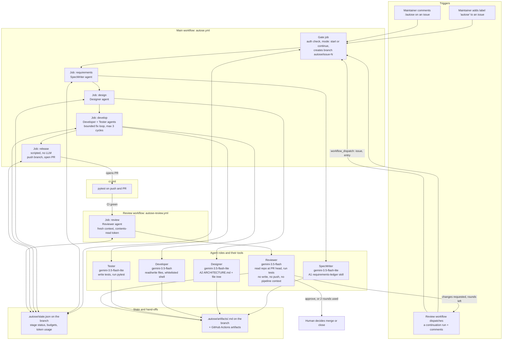

# Component view

Model names in the original diagram are historical committed defaults. Current repo variables select3.5-flash-lite for all roles. Full A1 output/validation correction is ADR015; old stage checkpoints are historical, not proof of full compliance.

The system is two GitHub Actions workflows, five LLM agent roles, one scripted
release step, a deterministic controller, and a state file on the work branch.

## What each piece is

| Component | Kind | Responsibility |
| --- | --- | --- |
| Gate job | Scripted | Authenticate the trigger (only the repo owner), decide start vs continue, create or reuse the work branch, load `state.json`. |
| SpecWriter | LLM agent (lite default) | Turn the issue into `spec.md` with testable acceptance criteria, using my A1 requirements-ledger skill. |
| Designer | LLM agent (lite default) | Turn the spec into `design.md`: approach plus the exact files and functions to change, guided by my A2 `ARCHITECTURE.md`. |
| Developer | LLM agent (flash default) | Edit the code on the work branch following the design; produces `diff.patch`. |
| Tester | LLM agent (lite default) | Write one test per acceptance criterion, run the full suite, produce `test_report.md`; on failure hand back to the Developer inside the same job, at most 3 cycles. |
| Release | Scripted `gh` calls | Commit artifacts, push the branch, open the pull request, write `pr.md`. |
| Reviewer | LLM agent (flash default) | Review the PR seeing only the issue, the diff and the repo at the PR head; approve or request changes with a classification (approach vs code). |
| Controller (`controller.py`) | Scripted | The state machine: which stage runs next, whether a check passed, when budgets are exhausted. LLMs never decide flow. |
| `state.json` | File on branch | Stage status, review rounds, fix cycles, cumulative token usage. Supports recovery of passed checkpoints; earlier failed-stage edits were not always retained. |

## Trust boundaries and measured gaps

- Issue/comment text is untrusted input and is delimited in prompts. That
  is a prompt-level defense, not containment.
- File-write tools refuse protected paths; shell commands use prefix checks.
  Python and shell composition still permit arbitrary execution, including
  network access. These controls are not a sandbox (ADR013).
- Gate, stage commit and release steps push only to the owned fork. Agents
  lack an explicit push tool; arbitrary execution remains a security gap.
- The reviewer has contents-read permission, review/comment writes and
  continuation dispatch permission. Its clean source copy excludes stored
  pipeline reasoning and git history, and has no explicit file-write tool.
  This is not a hardened runtime security boundary.
- Default model names above describe committed configuration. Recovery
  overrides and responding-model counts must be read from actual usage.
- No automatic merge exists. A person retains the merge decision.
- CI is rerun directly in the release job before dispatching review; some
  separate ci.yml events were action_required rather than passing.
